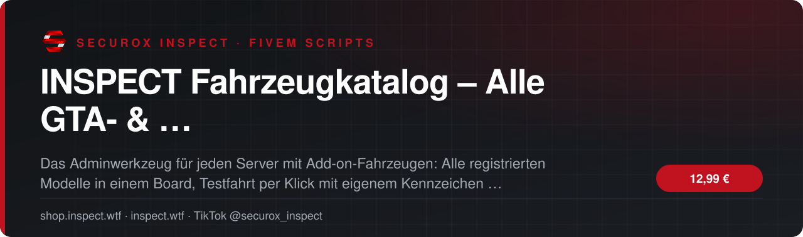
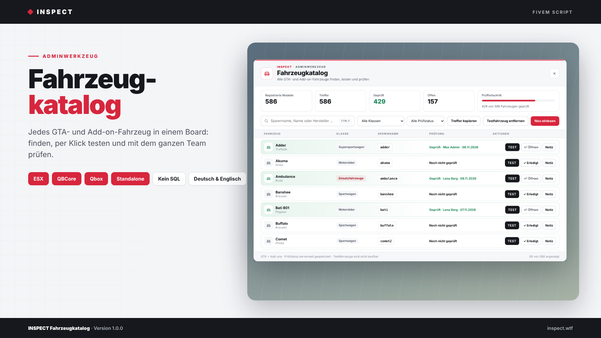
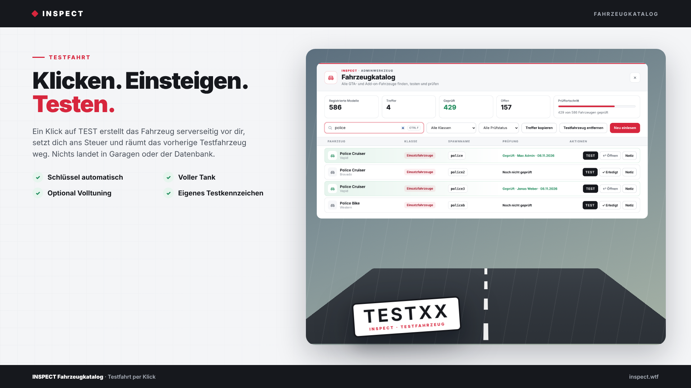
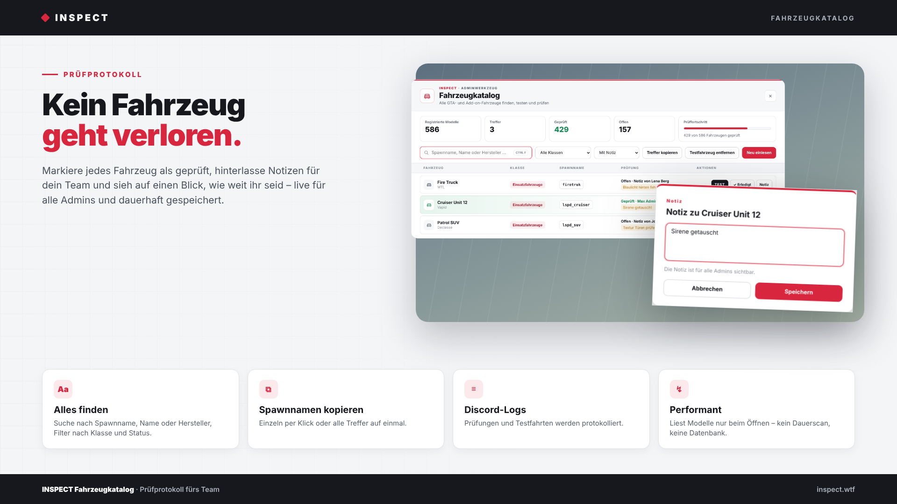

<!-- inspect-showcase: automatisch erzeugt, Änderungen bitte im Shop vornehmen -->

  
  
  
  
  

  
  
  

 

> 🇬🇧 **English:** INSPECT Fahrzeugkatalog – Alle GTA- & Add-on-Fahrzeuge finden, testen und prüfen – FiveM script (ESX, QBCore, Qbox) by SecuroX Inspect. Purchase and licensing exclusively at [shop.inspect.wtf](https://shop.inspect.wtf). Product details below are in German – questions are welcome on [Discord](https://discord.gg/inspect).

 

## Das Wichtigste auf einen Blick

<table>
  <tr>
    <td width="50%" valign="top">✔&nbsp; <b>Kompatibilität · ESX Legacy, QBCore und Qbox mit automatischer Framework-Erkennung, zusätzlich Standalone über ACE</b></td>
    <td width="50%" valign="top">✔&nbsp; <b>Kompatibilität · Keine Datenbank nötig – Prüfstatus wird serverseitig in der Ressource gespeichert</b></td>
  </tr>
  <tr>
    <td width="50%" valign="top">✔&nbsp; <b>Kompatibilität · Benachrichtigungen über eigenes INSPECT-Toast, ox_lib, ESX, QBCore oder GTA-Standard</b></td>
    <td width="50%" valign="top">✔&nbsp; <b>Katalog · Alle registrierten GTA- und Add-on-Fahrzeuge live aus dem Spiel gelesen</b></td>
  </tr>
</table>

## Überblick

Schluss mit Spawnnamen-Listen in Excel.

Wer viele Add-on-Fahrzeuge einbindet, kennt das Problem: Welches Modell heißt wie? Spawnt es überhaupt? Sind Lichter, Sirene und Texturen in Ordnung – und wer aus dem Team hat es schon geprüft? INSPECT Fahrzeugkatalog liest beim Öffnen alle registrierten GTA- und Add-on-Fahrzeuge direkt aus dem Spiel und zeigt sie mit Name, Hersteller, Klasse und Spawnname in einem übersichtlichen Board.

In Sekunden gefunden  
Suche nach Spawnname, Fahrzeugname oder Hersteller und filtere nach Fahrzeugklasse oder Prüfstatus. Ein Klick kopiert den Spawnnamen, ein weiterer alle Treffer auf einmal – ideal für Fahrzeughändler, Garagen und Jobfahrzeuge.

Testfahrt per Klick  
Ein Klick auf TEST erstellt das Fahrzeug serverseitig über OneSync vor dir, setzt dich ans Steuer und entfernt dein vorheriges Testfahrzeug automatisch. Testfahrzeuge erhalten ein eigenes Kennzeichen, auf Wunsch Schlüssel, vollen Tank und Volltuning – und landen niemals in Garagen oder der Datenbank.

Prüfprotokoll fürs ganze Team  
Markiere jedes Fahrzeug als geprüft. Name des Admins und Datum werden automatisch gespeichert, Notizen wie „Sirene fehlt“ sind für alle sichtbar. Ein Fortschrittsbalken zeigt, wie weit ihr seid. Alle Änderungen erscheinen sofort in jedem geöffneten Board und bleiben nach Neustarts erhalten.

Sauber und sicher  
Jede Aktion wird serverseitig auf Adminrechte geprüft. Der Katalog läuft ohne Dauerscan und ohne Datenbank, Spawns sind mit Cooldown abgesichert. Prüfungen und Testfahrten lassen sich per Discord-Webhook protokollieren.

Schnell installiert  
Ordner einfügen, ensure eintragen, ACE-Recht vergeben – fertig. Framework, Sprache, Kennzeichen und Integrationen stellt ihr in einer übersichtlichen Config ein. Eine Anleitung auf Deutsch und Englisch liegt bei.

## Kompatibilität

| | |
|:--|:--|
| Frameworks | **ESX** · **QBCore** · **Qbox** · **Standalone** |
| Plattform | FiveM (GTA V) |

## Alle weiteren Funktionen

- Katalog · Anzeige von Fahrzeugname, Hersteller, Klasse und Spawnname
- Katalog · Suche nach Spawnname, Fahrzeugname oder Hersteller
- Katalog · Filter nach allen 23 Fahrzeugklassen sowie offen, geprüft oder mit Notiz
- Katalog · Spawnname per Klick kopieren, alle Treffer auf einmal kopieren
- Testfahrt · Serverseitiger OneSync-Spawn direkt vor dem Admin, automatisch ans Steuer
- Testfahrt · Eigenes Testkennzeichen, vorheriges Testfahrzeug wird automatisch entfernt
- Testfahrt · Schlüssel automatisch: qb-vehiclekeys, qbx_vehiclekeys, wasabi_carlock, MrNewbVehicleKeys, cd_garage
- Testfahrt · Voller Tank automatisch: ox_fuel, LegacyFuel, cdn-fuel, ps-fuel, lc_fuel
- Testfahrt · Optional Volltuning für Motor, Getriebe, Bremsen, Federung und Turbo
- Testfahrt · Nie in Garagen, owned_vehicles oder der Datenbank gespeichert

<b>16 weitere Funktionen anzeigen</b>

- Testfahrt · Aufräumen beim Verlassen des Servers und beim Neustart der Ressource
- Testfahrt · Unterstützt Autos, Motorräder, Boote, Hubschrauber, Flugzeuge, U-Boote und Trailer
- Prüfprotokoll · Geprüft-Status pro Fahrzeug mit Name des Admins und Datum
- Prüfprotokoll · Notizen pro Fahrzeug für das ganze Team
- Prüfprotokoll · Fortschrittsbalken über alle Fahrzeuge
- Prüfprotokoll · Änderungen sofort in allen geöffneten Boards sichtbar, dauerhaft gespeichert
- Protokoll · Discord-Webhook für Prüfungen und Testfahrten
- Sicherheit · Jede Aktion serverseitig auf Adminrechte geprüft, Spawn-Cooldown gegen Missbrauch
- Performance · Modelle werden nur beim Öffnen gelesen und zwischengespeichert – kein Dauerscan
- Design · Helles, klares Interface mit frei wählbarer Akzentfarbe
- Sprache · Deutsch und Englisch, weitere Sprachen einfach ergänzbar
- Entwickler · Exports für Prüfstatus und zum Öffnen des Katalogs
- Entwickler · Config, Bridges, Sprachdateien und Server-Config offen editierbar
- Rechte · ACE-Recht inspect.vehiclecatalog, Framework-Gruppen und eigener Rechte-Hook konfigurierbar
- Installation · Anleitung auf Deutsch und Englisch als README
- Voraussetzungen · OneSync

## Einblicke

<table>
  <tr>
    <td width="50%"></td>
    <td width="50%"></td>
  </tr>
</table>

## In Aktion sehen

- 🎞️ Videos direkt auf der [Produktseite im Shop](https://shop.inspect.wtf/produkt/inspect-fahrzeugkatalog)

Neue Clips und Vorschauen regelmäßig auf TikTok: **[@securox_inspect](https://www.tiktok.com/@securox_inspect)**

## Preis

**12,99 €** &nbsp;–&nbsp; einmaliger Kaufpreis · Download und Lizenz im Kundenkonto

Sichere Zahlung mit PayPal oder Kreditkarte · Rechnung als PDF · Support auf Deutsch

## So einfach geht's

1. **Im Shop kaufen** – sicher bezahlen mit PayPal oder Kreditkarte.
2. **Sofort loslegen** – Download und Lizenz stehen direkt nach Zahlungseingang in deinem Kundenkonto bereit, die Rechnung erhältst du als PDF.
3. **Einrichten** – bei Fragen hilft dir unser Support im Discord weiter.

## Warum INSPECT?

<table>
  <tr>
    <td width="50%" valign="top"><b>🇩🇪 Entwickelt in Deutschland</b> Konzeption, Entwicklung und Support aus einer Hand.</td>
    <td width="50%" valign="top"><b>💬 Persönlicher Support</b> Schnelle Hilfe auf Deutsch im INSPECT Discord.</td>
  </tr>
  <tr>
    <td width="50%" valign="top"><b>🔒 Sichere Zahlung</b> PayPal oder Kreditkarte, Rechnung automatisch als PDF.</td>
    <td width="50%" valign="top"><b>⚡ Sofort verfügbar</b> Download und Lizenz direkt nach der Zahlung im Kundenkonto.</td>
  </tr>
</table>

## Häufige Fragen

<b>Wie erhalte ich das Produkt?</b>

 

Nach bestätigter Zahlung stehen Download und Lizenz in deinem Kundenkonto bereit. Die Rechnung erhältst du als PDF.

<b>Welche Frameworks werden unterstützt?</b>

 

ESX, QBCore, Qbox, Standalone.

<b>Bekomme ich Hilfe bei der Einrichtung?</b>

 

Ja – unser Support hilft dir im [INSPECT Discord](https://discord.gg/inspect) persönlich und auf Deutsch.

<b>Wo kaufe ich offiziell?</b>

 

Ausschließlich im INSPECT Shop unter [shop.inspect.wtf](https://shop.inspect.wtf). Angebote von Dritten stammen nicht von uns.

## Kontakt

| | |
|:--|:--|
| 🛒 Shop | [shop.inspect.wtf](https://shop.inspect.wtf) |
| 🌐 Website | [inspect.wtf](https://inspect.wtf) |
| 💬 Discord | [discord.gg/inspect](https://discord.gg/inspect) |
| 🎬 TikTok | [@securox_inspect](https://www.tiktok.com/@securox_inspect) |
| ✉️ E-Mail | [info@inspect.wtf](mailto:info@inspect.wtf) |

---

<b>SecuroX Inspect</b> · Offizielle Produktpräsentation · Dieses Repository enthält keinen Quellcode und keine Produktdateien. 
Kauf und Lizenzen ausschließlich über <a href="https://shop.inspect.wtf">shop.inspect.wtf</a> · Inhalte werden automatisch aus dem Shop aktualisiert.

