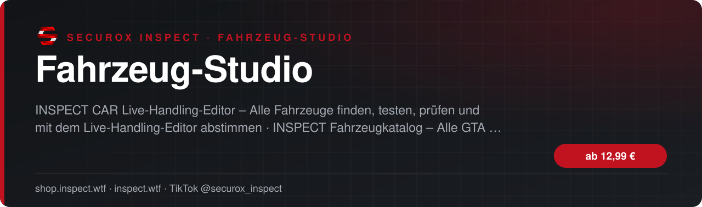
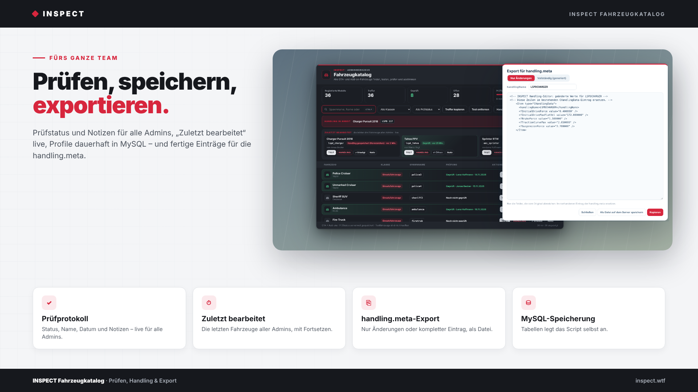
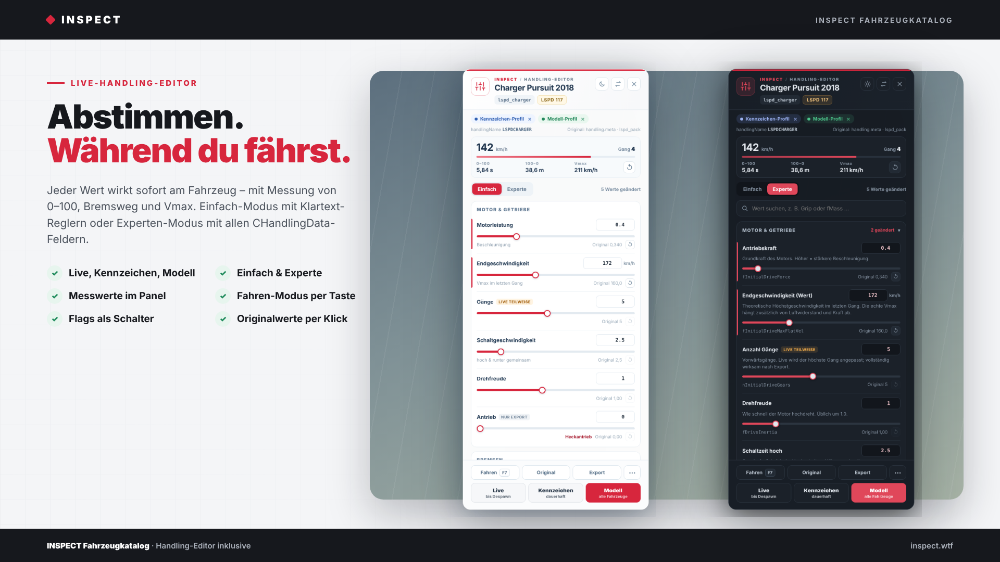
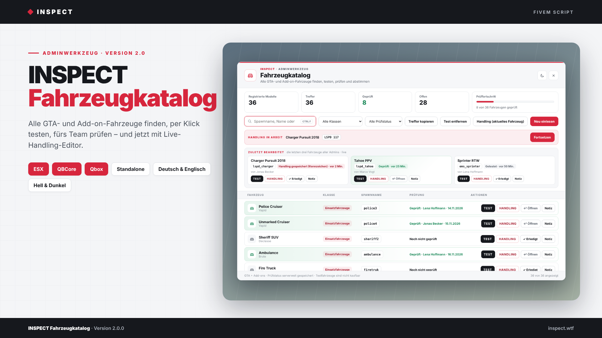
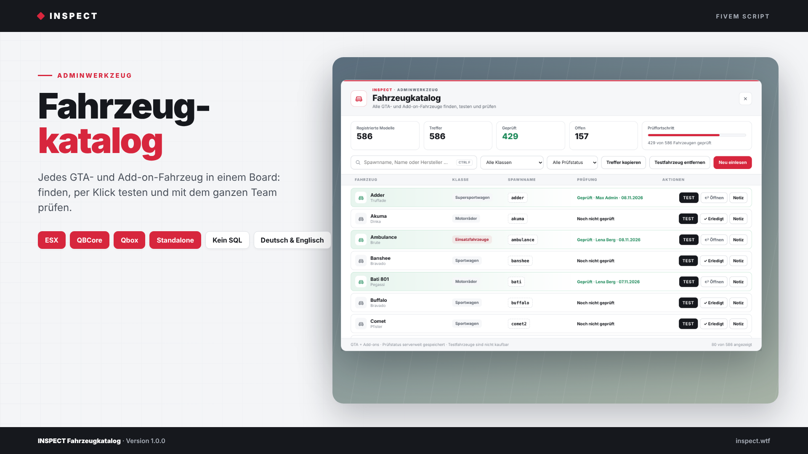
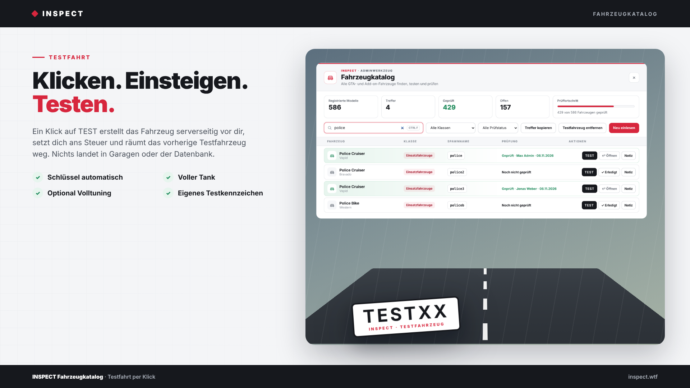
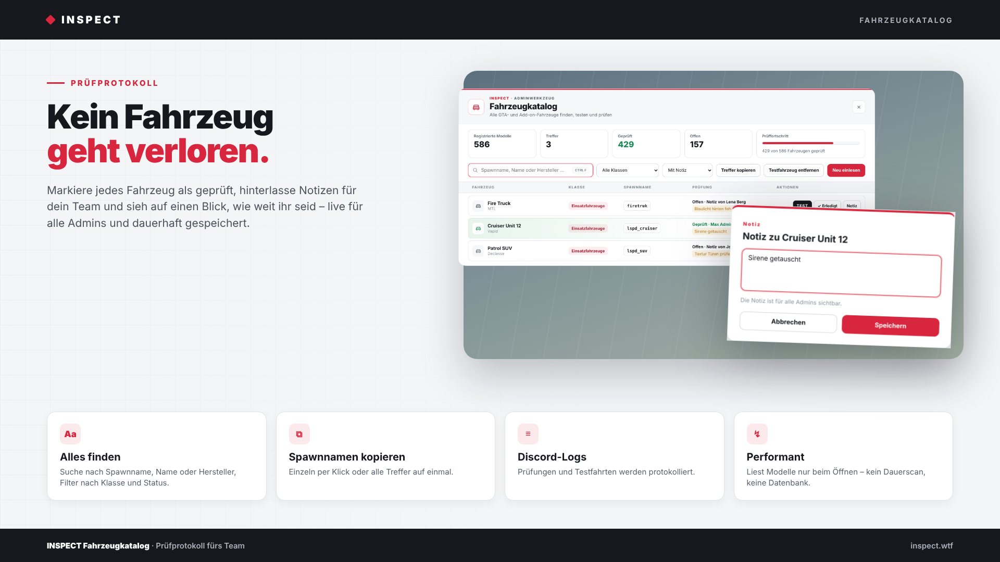

<!-- inspect-showcase: automatisch erzeugt, Änderungen bitte im Shop vornehmen -->

  
  
  
  

  
  
  

 

> 🇬🇧 **English:** Fahrzeug-Studio – browser-based FiveM vehicle editor for .ytd/.yft files – textures, 3D models and optimisation (ESX, QBCore, Qbox) by SecuroX Inspect. Purchase and licensing exclusively at [shop.inspect.wtf](https://shop.inspect.wtf). Product details below are in German – questions are welcome on [Discord](https://discord.gg/inspect).

 

## Überblick

Fahrzeuge finden, testen, prüfen – und jetzt live abstimmen.

Wer viele eigene Fahrzeuge einbindet, kennt das Problem: Welches Modell heißt wie? Spawnt es überhaupt? Sind Lichter, Sirene und Texturen in Ordnung, wer aus dem Team hat es schon geprüft – und warum fährt es sich wie ein Schrank? INSPECT Fahrzeugkatalog liest alle registrierten GTA- und Add-on-Fahrzeuge direkt aus dem Spiel und bringt Prüfung und Handling in ein Werkzeug.

In Sekunden gefunden  
Suche nach Spawnname, Fahrzeugname oder Hersteller, Filter nach Klasse, Prüfstatus oder Notiz. Ein Klick kopiert den Spawnnamen, ein weiterer alle Treffer.

Testfahrt per Klick  
TEST erstellt das Fahrzeug serverseitig über OneSync vor dir und setzt dich ans Steuer – mit eigenem Kennzeichen, auf Wunsch Schlüssel, vollem Tank und Volltuning. Testfahrzeuge landen nie in Garagen oder der Datenbank.

Live-Handling-Editor (neu in 2.0)  
HANDLING öffnet ein Seitenpanel direkt am Fahrzeug. Jeder Wert wirkt sofort, während du fährst. Einfach-Modus mit Klartext-Reglern, Experten-Modus mit allen CHandlingData-Feldern, Flags als Schalter mit Beschreibung. Messwerte für 0–100 km/h, Bremsweg und Vmax direkt im Panel. Gespeichert wird live für dieses Fahrzeug, dauerhaft pro Kennzeichen oder für das ganze Modell. Fertige Einträge für die handling.meta exportierst du mit einem Klick – nur die Änderungen oder den kompletten Eintrag inklusive SubHandlingData.

Prüfprotokoll fürs ganze Team  
Markiere Fahrzeuge als geprüft, Name und Datum werden automatisch gespeichert, Notizen wie „Sirene fehlt“ sieht jeder Admin. „Zuletzt bearbeitet“ zeigt live die letzten Fahrzeuge aller Admins, mit Fortsetzen ohne neuen Spawn.

Sauber und sicher  
Jede Aktion wird serverseitig auf Adminrechte geprüft, jede Handling-Speicherung auf Fahrzeug, Modell, Felder und Wertebereiche. Profile werden nur am eigenen Fahrzeug angewendet, ohne Dauerscan. Alle Daten liegen in MySQL, die Tabellen legt das Script selbst an.

Schnell installiert  
Ordner einfügen, nach oxmysql starten, ACE-Recht vergeben – fertig. Helles und dunkles Design, Deutsch und Englisch.

Voraussetzungen: oxmysql und OneSync.

## Produkte & Preise

| Produkt | Wofür | Preis | |
|:--|:--|--:|:--:|
| **INSPECT CAR Live-Handling-Editor – Alle Fahrzeuge finden, testen, prüfen und mit dem Live-Handling-Editor abstimmen** ⭐ Empfehlung | Das Adminwerkzeug für jeden Server mit eigenen Fahrzeugen: Alle Modelle in einem Board, Testfahrt per Klick, Prüfprotokoll fürs Team und neu in 2.0 ein Live-Handling-Editor mit Messwerten, Kennzeichen- und Modellprofilen und handling.meta-Export. ESX, QBCore, Qbox oder Standalone, Deutsch und Englisch. | 39,99 € | [Kaufen](https://shop.inspect.wtf/produkt/inspect-fahrzeugkatalog) |
| **INSPECT Fahrzeugkatalog – Alle GTA- & Add-on-Fahrzeuge finden, testen und prüfen** | Das Adminwerkzeug für jeden Server mit Add-on-Fahrzeugen: Alle registrierten Modelle in einem Board, Testfahrt per Klick mit eigenem Kennzeichen, Schlüssel und vollem Tank sowie ein Prüfprotokoll mit Name, Datum und Notizen fürs ganze Team. ESX, QBCore, Qbox oder Standalone – ohne Datenbank. | 12,99 € | [Kaufen](https://shop.inspect.wtf/produkt/inspect-fahrzeugkatalog) |

## Kompatibilität

| | |
|:--|:--|
| Frameworks | **ESX** · **QBCore** · **Qbox** · **Standalone** |
| Plattform | FiveM (GTA V) |

## Einblicke

<table>
  <tr>
    <td width="50%"></td>
    <td width="50%"></td>
  </tr>
  <tr>
    <td width="50%"></td>
    <td width="50%"></td>
  </tr>
  <tr>
    <td width="50%"></td>
    <td width="50%"></td>
  </tr>
</table>

## In Aktion sehen

- 🎞️ Videos zu INSPECT CAR Live-Handling-Editor – Alle Fahrzeuge finden, testen, prüfen und mit dem Live-Handling-Editor abstimmen direkt auf der [Produktseite im Shop](https://shop.inspect.wtf/produkt/inspect-fahrzeugkatalog)
- 🎞️ Videos zu INSPECT Fahrzeugkatalog – Alle GTA- & Add-on-Fahrzeuge finden, testen und prüfen direkt auf der [Produktseite im Shop](https://shop.inspect.wtf/produkt/inspect-fahrzeugkatalog)

Neue Clips und Vorschauen regelmäßig auf TikTok: **[@securox_inspect](https://www.tiktok.com/@securox_inspect)**

## Details zu den Produkten

<b>INSPECT CAR Live-Handling-Editor – Alle Fahrzeuge finden, testen, prüfen und mit dem Live-Handling-Editor abstimmen</b> · 39,99 €

 

Fahrzeuge finden, testen, prüfen – und jetzt live abstimmen.

Wer viele eigene Fahrzeuge einbindet, kennt das Problem: Welches Modell heißt wie? Spawnt es überhaupt? Sind Lichter, Sirene und Texturen in Ordnung, wer aus dem Team hat es schon geprüft – und warum fährt es sich wie ein Schrank? INSPECT Fahrzeugkatalog liest alle registrierten GTA- und Add-on-Fahrzeuge direkt aus dem Spiel und bringt Prüfung und Handling in ein Werkzeug.

In Sekunden gefunden  
Suche nach Spawnname, Fahrzeugname oder Hersteller, Filter nach Klasse, Prüfstatus oder Notiz. Ein Klick kopiert den Spawnnamen, ein weiterer alle Treffer.

Testfahrt per Klick  
TEST erstellt das Fahrzeug serverseitig über OneSync vor dir und setzt dich ans Steuer – mit eigenem Kennzeichen, auf Wunsch Schlüssel, vollem Tank und Volltuning. Testfahrzeuge landen nie in Garagen oder der Datenbank.

Live-Handling-Editor (neu in 2.0)  
HANDLING öffnet ein Seitenpanel direkt am Fahrzeug. Jeder Wert wirkt sofort, während du fährst. Einfach-Modus mit Klartext-Reglern, Experten-Modus mit allen CHandlingData-Feldern, Flags als Schalter mit Beschreibung. Messwerte für 0–100 km/h, Bremsweg und Vmax direkt im Panel. Gespeichert wird live für dieses Fahrzeug, dauerhaft pro Kennzeichen oder für das ganze Modell. Fertige Einträge für die handling.meta exportierst du mit einem Klick – nur die Änderungen oder den kompletten Eintrag inklusive SubHandlingData.

Prüfprotokoll fürs ganze Team  
Markiere Fahrzeuge als geprüft, Name und Datum werden automatisch gespeichert, Notizen wie „Sirene fehlt“ sieht jeder Admin. „Zuletzt bearbeitet“ zeigt live die letzten Fahrzeuge aller Admins, mit Fortsetzen ohne neuen Spawn.

Sauber und sicher  
Jede Aktion wird serverseitig auf Adminrechte geprüft, jede Handling-Speicherung auf Fahrzeug, Modell, Felder und Wertebereiche. Profile werden nur am eigenen Fahrzeug angewendet, ohne Dauerscan. Alle Daten liegen in MySQL, die Tabellen legt das Script selbst an.

Schnell installiert  
Ordner einfügen, nach oxmysql starten, ACE-Recht vergeben – fertig. Helles und dunkles Design, Deutsch und Englisch.

Voraussetzungen: oxmysql und OneSync.

- Kompatibilität · ESX Legacy, QBCore, Qbox oder Standalone über ACE
- Kompatibilität · Schlüssel: qb-vehiclekeys, qbx_vehiclekeys, wasabi_carlock, MrNewbVehicleKeys, cd_garage
- Kompatibilität · Tank: ox_fuel, LegacyFuel, cdn-fuel, ps-fuel, lc_fuel
- Katalog · Alle registrierten GTA- und Add-on-Fahrzeuge direkt aus dem Spiel
- Katalog · Suche nach Spawnname, Name oder Hersteller, Filter nach Klasse, Status und Notiz
- Katalog · Spawnnamen einzeln oder alle Treffer kopieren
- Testfahrt · Serverseitiger OneSync-Spawn mit eigenem Kennzeichen
- Testfahrt · Schlüssel, voller Tank und optionales Volltuning
- Testfahrt · Vorheriges Testfahrzeug wird automatisch entfernt
- Prüfung · Status mit Name, Datum und Notiz – live für alle Admins
- Prüfung · Fortschrittsbalken für das ganze Team
- Verlauf · Zuletzt bearbeitet: die letzten Fahrzeuge aller Admins, live
- Handling · Live-Editor direkt am Fahrzeug, jeder Wert wirkt sofort
- Handling · Einfach-Modus mit Klartext-Reglern
- Handling · Experten-Modus mit allen CHandlingData-Feldern, Suche, Vektoren und Flags
- Handling · Speichern live, pro Kennzeichen oder für das ganze Modell
- Handling · Messwerte 0–100 km/h, Bremsweg 100–0 und Vmax im Panel
- Handling · Fahren-Modus per Taste, Panel links oder rechts
- Handling · Export für die handling.meta inkl. SubHandlingData, optional als Datei
- Handling · Kennzeichen-Profile folgen dem Fahrzeug durch Garage und Neustart
- Handling · Werte von Tuning und anderen Scripts bleiben erhalten
- Handling · Fortsetzen ohne neuen Spawn
- Sicherheit · Serverseitige Prüfung von Rechten, Fahrzeug, Modell, Feldern und Wertebereichen
- Performance · Profile nur am eigenen Fahrzeug, kein Dauerscan
- Speicherung · MySQL, Tabellen werden automatisch angelegt
- Design · Helles und dunkles Design, pro Admin gemerkt
- Logs · Discord-Webhook für Prüfungen und Testfahrten
- Sprache · Komplett auf Deutsch und Englisch
- Exports · Prüfstatus, Handling-Profile und Kennzeichen-Wechsel für andere Scripts
- Voraussetzungen · oxmysql und OneSync

**39,99 €** &nbsp;–&nbsp; einmaliger Kaufpreis · Download und Lizenz im Kundenkonto

**[➜ INSPECT CAR Live-Handling-Editor – Alle Fahrzeuge finden, testen, prüfen und mit dem Live-Handling-Editor abstimmen im Shop kaufen](https://shop.inspect.wtf/produkt/inspect-fahrzeugkatalog)**

<b>INSPECT Fahrzeugkatalog – Alle GTA- &amp; Add-on-Fahrzeuge finden, testen und prüfen</b> · 12,99 €

 

Schluss mit Spawnnamen-Listen in Excel.

Wer viele Add-on-Fahrzeuge einbindet, kennt das Problem: Welches Modell heißt wie? Spawnt es überhaupt? Sind Lichter, Sirene und Texturen in Ordnung – und wer aus dem Team hat es schon geprüft? INSPECT Fahrzeugkatalog liest beim Öffnen alle registrierten GTA- und Add-on-Fahrzeuge direkt aus dem Spiel und zeigt sie mit Name, Hersteller, Klasse und Spawnname in einem übersichtlichen Board.

In Sekunden gefunden  
Suche nach Spawnname, Fahrzeugname oder Hersteller und filtere nach Fahrzeugklasse oder Prüfstatus. Ein Klick kopiert den Spawnnamen, ein weiterer alle Treffer auf einmal – ideal für Fahrzeughändler, Garagen und Jobfahrzeuge.

Testfahrt per Klick  
Ein Klick auf TEST erstellt das Fahrzeug serverseitig über OneSync vor dir, setzt dich ans Steuer und entfernt dein vorheriges Testfahrzeug automatisch. Testfahrzeuge erhalten ein eigenes Kennzeichen, auf Wunsch Schlüssel, vollen Tank und Volltuning – und landen niemals in Garagen oder der Datenbank.

Prüfprotokoll fürs ganze Team  
Markiere jedes Fahrzeug als geprüft. Name des Admins und Datum werden automatisch gespeichert, Notizen wie „Sirene fehlt“ sind für alle sichtbar. Ein Fortschrittsbalken zeigt, wie weit ihr seid. Alle Änderungen erscheinen sofort in jedem geöffneten Board und bleiben nach Neustarts erhalten.

Sauber und sicher  
Jede Aktion wird serverseitig auf Adminrechte geprüft. Der Katalog läuft ohne Dauerscan und ohne Datenbank, Spawns sind mit Cooldown abgesichert. Prüfungen und Testfahrten lassen sich per Discord-Webhook protokollieren.

Schnell installiert  
Ordner einfügen, ensure eintragen, ACE-Recht vergeben – fertig. Framework, Sprache, Kennzeichen und Integrationen stellt ihr in einer übersichtlichen Config ein. Eine Anleitung auf Deutsch und Englisch liegt bei.

- Kompatibilität · ESX Legacy, QBCore und Qbox mit automatischer Framework-Erkennung, zusätzlich Standalone über ACE
- Kompatibilität · Keine Datenbank nötig – Prüfstatus wird serverseitig in der Ressource gespeichert
- Kompatibilität · Benachrichtigungen über eigenes INSPECT-Toast, ox_lib, ESX, QBCore oder GTA-Standard
- Katalog · Alle registrierten GTA- und Add-on-Fahrzeuge live aus dem Spiel gelesen
- Katalog · Anzeige von Fahrzeugname, Hersteller, Klasse und Spawnname
- Katalog · Suche nach Spawnname, Fahrzeugname oder Hersteller
- Katalog · Filter nach allen 23 Fahrzeugklassen sowie offen, geprüft oder mit Notiz
- Katalog · Spawnname per Klick kopieren, alle Treffer auf einmal kopieren
- Testfahrt · Serverseitiger OneSync-Spawn direkt vor dem Admin, automatisch ans Steuer
- Testfahrt · Eigenes Testkennzeichen, vorheriges Testfahrzeug wird automatisch entfernt
- Testfahrt · Schlüssel automatisch: qb-vehiclekeys, qbx_vehiclekeys, wasabi_carlock, MrNewbVehicleKeys, cd_garage
- Testfahrt · Voller Tank automatisch: ox_fuel, LegacyFuel, cdn-fuel, ps-fuel, lc_fuel
- Testfahrt · Optional Volltuning für Motor, Getriebe, Bremsen, Federung und Turbo
- Testfahrt · Nie in Garagen, owned_vehicles oder der Datenbank gespeichert
- Testfahrt · Aufräumen beim Verlassen des Servers und beim Neustart der Ressource
- Testfahrt · Unterstützt Autos, Motorräder, Boote, Hubschrauber, Flugzeuge, U-Boote und Trailer
- Prüfprotokoll · Geprüft-Status pro Fahrzeug mit Name des Admins und Datum
- Prüfprotokoll · Notizen pro Fahrzeug für das ganze Team
- Prüfprotokoll · Fortschrittsbalken über alle Fahrzeuge
- Prüfprotokoll · Änderungen sofort in allen geöffneten Boards sichtbar, dauerhaft gespeichert
- Protokoll · Discord-Webhook für Prüfungen und Testfahrten
- Sicherheit · Jede Aktion serverseitig auf Adminrechte geprüft, Spawn-Cooldown gegen Missbrauch
- Performance · Modelle werden nur beim Öffnen gelesen und zwischengespeichert – kein Dauerscan
- Design · Helles, klares Interface mit frei wählbarer Akzentfarbe
- Sprache · Deutsch und Englisch, weitere Sprachen einfach ergänzbar
- Entwickler · Exports für Prüfstatus und zum Öffnen des Katalogs
- Entwickler · Config, Bridges, Sprachdateien und Server-Config offen editierbar
- Rechte · ACE-Recht inspect.vehiclecatalog, Framework-Gruppen und eigener Rechte-Hook konfigurierbar
- Installation · Anleitung auf Deutsch und Englisch als README
- Voraussetzungen · OneSync

**12,99 €** &nbsp;–&nbsp; einmaliger Kaufpreis · Download und Lizenz im Kundenkonto

**[➜ INSPECT Fahrzeugkatalog – Alle GTA- & Add-on-Fahrzeuge finden, testen und prüfen im Shop kaufen](https://shop.inspect.wtf/produkt/inspect-fahrzeugkatalog)**

Sichere Zahlung mit PayPal oder Kreditkarte · Rechnung als PDF · Support auf Deutsch

## So einfach geht's

1. **Im Shop kaufen** – sicher bezahlen mit PayPal oder Kreditkarte.
2. **Sofort loslegen** – Download und Lizenz stehen direkt nach Zahlungseingang in deinem Kundenkonto bereit, die Rechnung erhältst du als PDF.
3. **Einrichten** – bei Fragen hilft dir unser Support im Discord weiter.

## Warum INSPECT?

<table>
  <tr>
    <td width="50%" valign="top"><b>🇩🇪 Entwickelt in Deutschland</b> Konzeption, Entwicklung und Support aus einer Hand.</td>
    <td width="50%" valign="top"><b>💬 Persönlicher Support</b> Schnelle Hilfe auf Deutsch im INSPECT Discord.</td>
  </tr>
  <tr>
    <td width="50%" valign="top"><b>🔒 Sichere Zahlung</b> PayPal oder Kreditkarte, Rechnung automatisch als PDF.</td>
    <td width="50%" valign="top"><b>⚡ Sofort verfügbar</b> Download und Lizenz direkt nach der Zahlung im Kundenkonto.</td>
  </tr>
</table>

## Häufige Fragen

<b>Wie erhalte ich das Produkt?</b>

 

Nach bestätigter Zahlung stehen Download und Lizenz in deinem Kundenkonto bereit. Die Rechnung erhältst du als PDF.

<b>Welche Frameworks werden unterstützt?</b>

 

ESX, QBCore, Qbox, Standalone.

<b>Bekomme ich Hilfe bei der Einrichtung?</b>

 

Ja – unser Support hilft dir im [INSPECT Discord](https://discord.gg/inspect) persönlich und auf Deutsch.

<b>Wo kaufe ich offiziell?</b>

 

Ausschließlich im INSPECT Shop unter [shop.inspect.wtf](https://shop.inspect.wtf). Angebote von Dritten stammen nicht von uns.

## Kontakt

| | |
|:--|:--|
| 🛒 Shop | [shop.inspect.wtf](https://shop.inspect.wtf) |
| 🌐 Website | [inspect.wtf](https://inspect.wtf) |
| 💬 Discord | [discord.gg/inspect](https://discord.gg/inspect) |
| 🎬 TikTok | [@securox_inspect](https://www.tiktok.com/@securox_inspect) |
| ✉️ E-Mail | [info@inspect.wtf](mailto:info@inspect.wtf) |

---

<b>SecuroX Inspect</b> · Offizielle Produktpräsentation · Dieses Repository enthält keinen Quellcode und keine Produktdateien. 
Kauf und Lizenzen ausschließlich über <a href="https://shop.inspect.wtf">shop.inspect.wtf</a> · Inhalte werden automatisch aus dem Shop aktualisiert.

